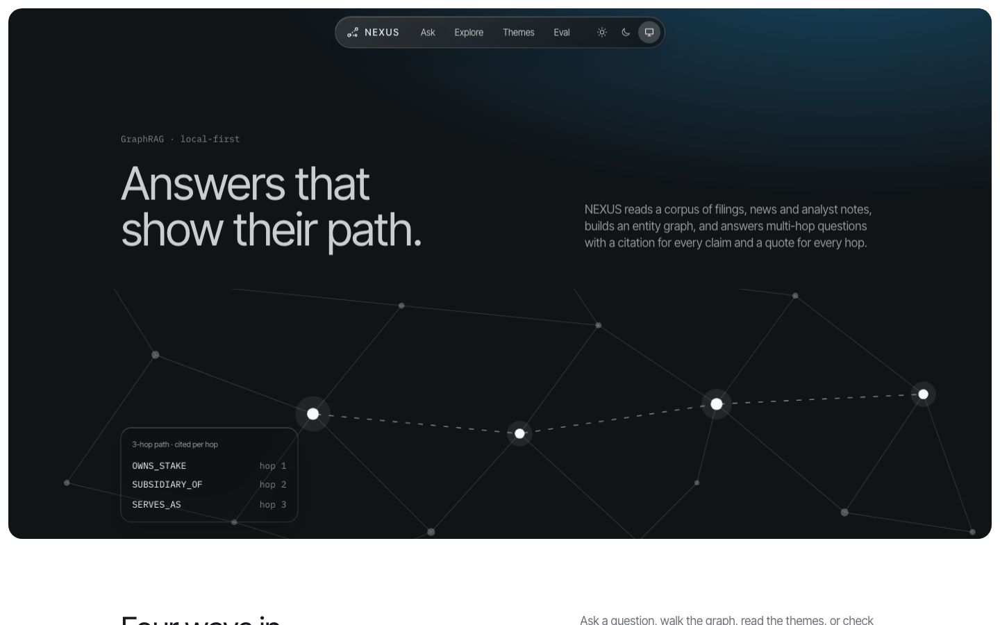
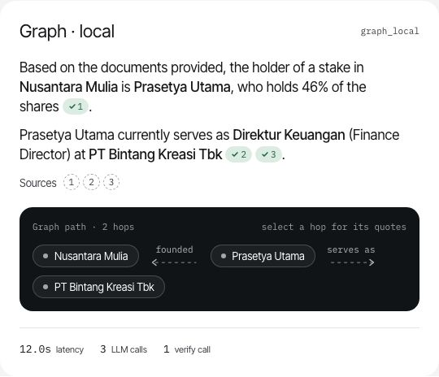
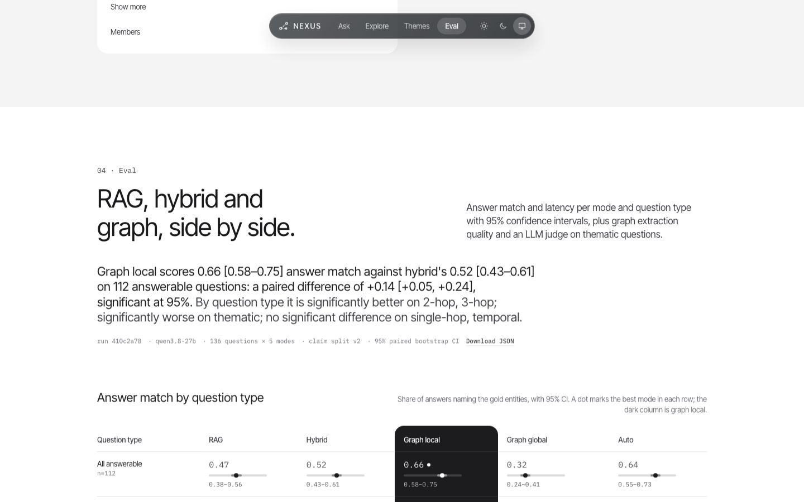

# NEXUS

NEXUS is a local-first GraphRAG portfolio project. It reads a synthetic Indonesian/English corpus of filings, news and analyst notes, builds a Neo4j entity graph with Leiden communities, and answers multi-hop questions with citations for every claim and a quote for every graph hop. A single-page UI lets you compare vector RAG, hybrid and graph retrieval side by side, explore the graph, read the community themes and inspect the evaluation.

> All companies and people in this repo are fictional. Any resemblance to real entities is coincidental.



| A multi-hop answer with its graph path | Evaluation: five modes, 95% CIs |
|---|---|
|  |  |

Full evaluation write-up: [docs/report/eval-report.md](docs/report/eval-report.md). More screenshots (light, dark, mobile) are in [docs/screenshots](docs/screenshots).

## Architecture

```
 docs/corpus ──► ingest ──► Postgres (documents, chunks, tenants)
                   │
                   ├──► Milvus (chunk + community embeddings)
                   │
                   └──► graph extract/build ──► Neo4j (entities, relations, provenance)
                                                  │
                                       communities + summarize
                                                  │
 question ──► FastAPI ──► classify ──► retrieve ──► rerank ──► generate ──► verify citations
                              (rag | hybrid | graph_local | graph_global | auto)
                                                  │
                         Next.js single page:  hero → #ask → #explore → #themes → #eval
```

## Quickstart

Backend:

```bash
# Postgres: local server on 5432 (or `podman-compose -f infra/compose.yaml up -d`, then POSTGRES_PORT=5433)
# Neo4j: `brew install neo4j && brew services start neo4j`
cp .env.example .env              # then fill LLM_API_KEY, POSTGRES_PASSWORD, NEO4J_PASSWORD
cd backend
uv sync
uv run nexus check                # pings Postgres, Milvus, Neo4j, LLM gateway
uv run nexus db migrate
```

Pipeline (the synthetic world is committed; re-run `datagen world` only to regenerate):

```bash
uv run nexus datagen world --seed 42
uv run nexus datagen docs
uv run nexus datagen reference      # ticker table (links tickers to companies)
uv run nexus ingest
uv run nexus graph extract
uv run nexus graph build
uv run nexus graph eval           # extraction/entity-resolution metrics → eval/runs/graph-<ts>.json
uv run nexus graph communities
uv run nexus graph summarize
uv run nexus eval questions
uv run nexus eval review-sheet     # optional: mark questions to exclude in eval/review/questions.csv
uv run nexus eval run --modes rag,hybrid,graph_local,graph_global,auto
uv run nexus eval rescore-claims --run <run-id> --verify
uv run nexus eval judge --run <run-id> --a graph_global --b hybrid --categories thematic
uv run nexus eval report --run <run-id> --rescored --graph ../eval/runs/graph-<ts>.json --judge ../eval/runs/judge-<run-id>-graph_global-vs-hybrid.json
```

Run `uv run nexus <command> --help` for each command's options.

API (restart it after every `graph build`: the entity lexicon used by `graph_local` is loaded at startup):

```bash
uv run uvicorn nexus.api.app:create_app --factory --port 8000
uv run ruff check . && uv run pytest   # dev checks
```

Frontend (Node >= 22):

```bash
cd frontend
cp .env.example .env.local        # NEXT_PUBLIC_API_URL defaults to http://localhost:8000
npm i && npm run dev
```

Production build and end-to-end tests (needs the API running):

```bash
npm run build && npm run start     # serves on :3000
npx playwright install chromium    # first run only
npm run e2e                        # desktop light/dark, mobile, reduced motion
```

Checks: `npm run lint && npm run typecheck && npm run test && npm run build`.

`multi_hop_3` questions need 3 or more hops.
