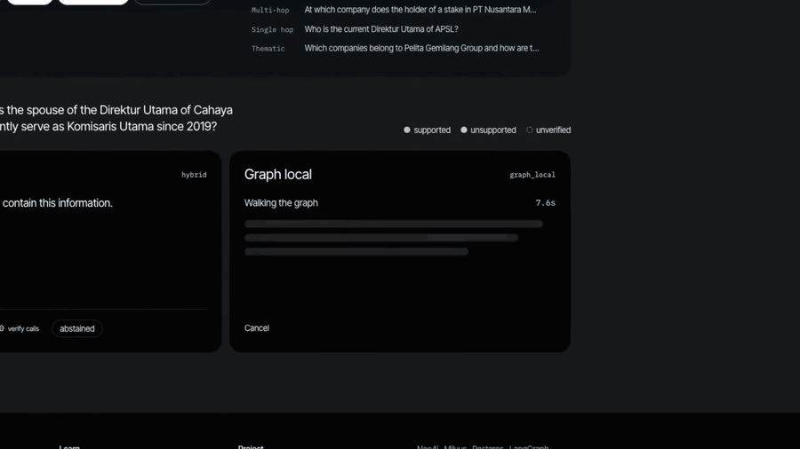
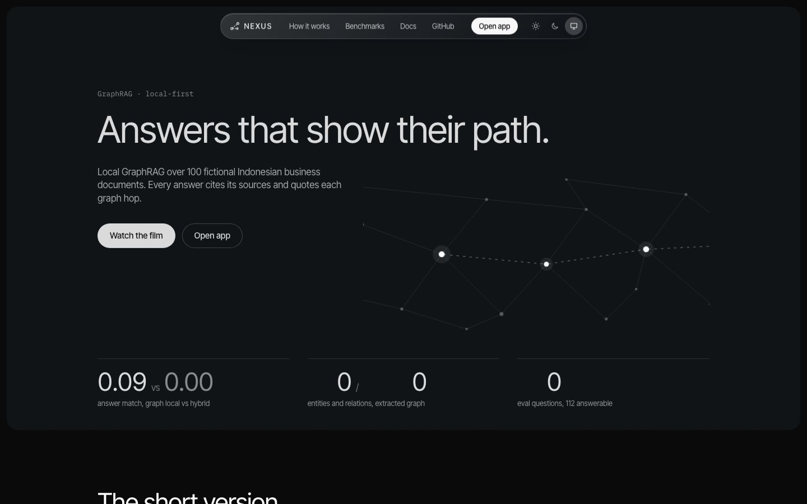
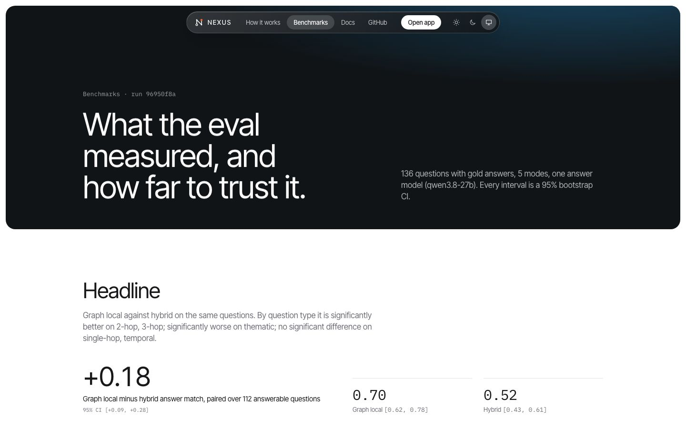
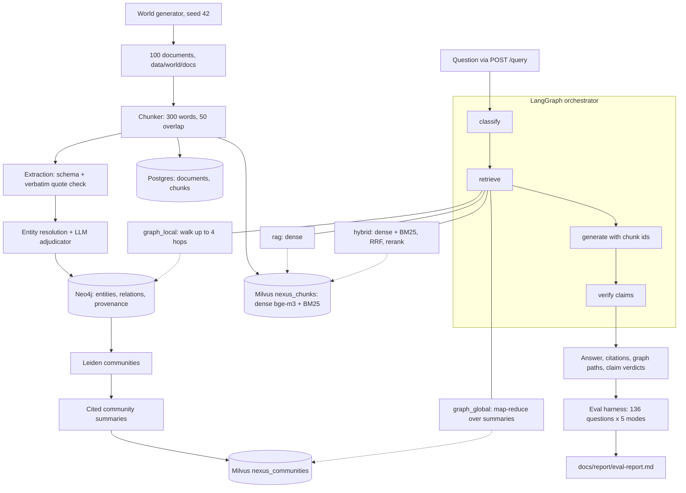

<div align="center">

<picture>
  <source media="(prefers-color-scheme: dark)" srcset="docs/brand/nexus-lockup-dark.svg">
  
</picture>

<h3>Answers that show their path.</h3>

<p>Local-first GraphRAG over a synthetic Indonesian/English corpus of company filings, with a cited source sentence for every graph hop.</p>

[](LICENSE)


</div>

**Some questions have an answer that no single document contains. NEXUS builds an entity graph from the documents, walks it, and answers with the path it took and the sentence behind each step.**

- **Measured against a baseline.** On 112 answerable questions, `graph_local` matches the gold answer 70% of the time and hybrid search 52% (paired difference +0.18, 95% CI [+0.09, +0.28]). On two- and three-hop questions hybrid scores 0.07 and 0.00; `graph_local` scores 0.64 and 0.55.
- **Every hop carries its quote.** Each Neo4j relationship stores the chunk ids, document ids and verbatim quote it was extracted from. A verifier then checks every sentence of the answer against the chunks it cites.
- **Runs on your own hardware.** Postgres, Neo4j and Milvus run locally or on a private network. Chat, embeddings and reranking go through an OpenAI-compatible gateway you host (LiteLLM in development). Nothing is sent to a hosted vector store or a third-party API.

> [!NOTE]
> Every company and person in this repo is fictional. Names are combinatorial and checked against a blocklist of real Indonesian conglomerates and tickers. Any resemblance to a real entity is coincidental.

<p align="center">
  
</p>

<p align="center"><i>Hybrid search says the answer isn't there. <code>graph_local</code> walks three hops across three documents and returns PT Karya Semesta, with a quote for each hop. 15 s cut from the <a href="frontend/public/film/nexus-demo.mp4">105.6 s demo film</a> (real app, live stack; the graph walk itself is drawn from the API's returned path, see <a href="film/README.md">film/README.md</a>).</i></p>

| Landing page | Ask: one question, several modes | Benchmarks |
|---|---|---|
|  |  |  |

More screenshots (light, dark, mobile) are in [docs/screenshots](docs/screenshots).

---

## Contents

[Get started](#get-started) · [See it in action](#see-it-in-action) · [What it does](#what-it-does) · [Which mode when](#when-to-reach-for-which-mode) · [Benchmarks](#benchmarks-graph_local-070-vs-hybrid-052-answer-match-018-009-028) · [Architecture](#architecture) · [Configuration](#configuration) · [Project layout](#project-layout) · [Privacy](#privacy-and-local-only-stance) · [Troubleshooting](#troubleshooting) · [Limitations](#limitations) · [License](#license)

---

## Get started

### Prerequisites

| Tool | Version | Notes |
|---|---|---|
| Python | 3.12 | managed by [uv](https://docs.astral.sh/uv/) (`requires-python = ">=3.12,<3.13"`) |
| Node | ≥ 22 | developed on Node 26 |
| Postgres | 16 | local server on 5432, or `infra/compose.yaml` (port 5433) |
| Neo4j | 5 | `brew install neo4j`, or `infra/compose.yaml` |
| Milvus | 2.5 | `pymilvus` is pinned to `>=2.5,<2.6`; hybrid search uses Milvus's built-in BM25 |
| LLM gateway | OpenAI-compatible | serves `qwen3.8-27b` (chat), `bge-m3` (embeddings), `qwen3-reranker-4b` (rerank) |

> [!IMPORTANT]
> Milvus may be shared infrastructure. NEXUS only creates and reads collections whose names start with `nexus_` (`nexus_chunks`, `nexus_communities`). `MILVUS_COLLECTION_PREFIX` must start with `nexus_`; the settings loader refuses to start otherwise.

### Install

```bash
# Postgres: local server on 5432 (or `podman-compose --env-file .env -f infra/compose.yaml up -d`, then POSTGRES_PORT=5433)
# Neo4j: `brew install neo4j && brew services start neo4j`
cp .env.example .env              # then fill LLM_API_KEY, POSTGRES_PASSWORD, NEO4J_PASSWORD
cd backend
uv sync
uv run nexus check                # pings Postgres, Milvus, Neo4j, LLM gateway
uv run nexus db migrate
```

The compose file creates Postgres with user, password and database all set to `nexus`, so set `POSTGRES_USER=nexus` and `POSTGRES_PASSWORD=nexus` along with the port if you use it.

### `.env`

The backend reads `.env` at the repo root. Secrets stay blank in `.env.example`; the full key list is in [Configuration](#configuration).

```dotenv
LLM_BASE_URL=http://localhost:4000      # or http://<llm-gateway-host>:4000
LLM_API_KEY=
POSTGRES_PASSWORD=
NEO4J_PASSWORD=
MILVUS_HOST=localhost
MILVUS_COLLECTION_PREFIX=nexus_
```

### Run the pipeline

The synthetic world is committed; re-run `datagen world` only to regenerate it.

```bash
uv run nexus datagen world --seed 42
uv run nexus datagen docs
uv run nexus datagen reference      # ticker table (links tickers to companies)
uv run nexus ingest
uv run nexus graph extract
uv run nexus graph build
uv run nexus graph eval           # extraction/entity-resolution metrics → eval/runs/graph-<ts>.json
uv run nexus graph communities
uv run nexus graph summarize
uv run nexus eval questions
uv run nexus eval review-sheet     # optional: mark questions to exclude in eval/review/questions.csv
uv run nexus eval run --modes rag,hybrid,graph_local,graph_global,auto
uv run nexus eval rescore-claims --run <run-id> --verify
uv run nexus eval judge --run <run-id> --a graph_global --b hybrid --categories thematic
uv run nexus eval report --run <run-id> --rescored --graph ../eval/runs/graph-<ts>.json --judge ../eval/runs/judge-<run-id>-graph_global-vs-hybrid.json
```

Run `uv run nexus <command> --help` for each command's options. Most take `--tenant` (default `demo`); `graph extract`, `graph build` and `graph summarize` take `--workers` (default 4).

### Start the API and the UI

API (restart it after every `graph build`: the entity lexicon used by `graph_local` is loaded at startup):

```bash
uv run uvicorn nexus.api.app:create_app --factory --port 8000
uv run ruff check . && uv run pytest   # dev checks
```

Frontend (Node >= 22):

```bash
cd frontend
cp .env.example .env.local        # NEXT_PUBLIC_API_URL defaults to http://localhost:8000
npm i && npm run dev
```

Production build and end-to-end tests (needs the API running):

```bash
npm run build && npm run start     # serves on :3000
npx playwright install chromium    # first run only
npm run e2e                        # desktop light/dark, mobile, reduced motion
```

Checks: `npm run lint && npm run typecheck && npm run test && npm run build`.

### What you end up with

```text
data/world/
├── ground_truth.json          # planted world: 429 entities, 1,434 relations (datagen world)
├── doc_facts.json             # which world relations each document states
└── docs/                      # 100 generated documents + ref_001 ticker table (datagen docs/reference)
eval/
├── questions.jsonl            # 136 questions with gold answers (eval questions)
├── review/questions.csv       # human review sheet (eval review-sheet)
└── runs/
    ├── <run-id>.json / .md                 # raw run (eval run)
    ├── <run-id>.rescored.json / .md        # claims re-split and re-verified (eval rescore-claims)
    ├── graph-<ts>.json                     # graph quality scores (graph eval)
    └── judge-<run-id>-<a>-vs-<b>.json      # pairwise LLM judge (eval judge)
docs/report/
├── eval-report.md             # the write-up (eval report)
└── eval-report.json           # same numbers, served by GET /eval/report
```

Postgres holds documents and chunks, Milvus holds `nexus_chunks` and `nexus_communities`, and Neo4j holds the entity graph with provenance and communities.

---

## See it in action

The question from the film. The answer needs three facts that sit in three different documents: who runs PT Cahaya Teguh, who that person is married to, and which board the spouse chairs.

```bash
curl -s localhost:8000/query \
  -H 'Content-Type: application/json' -H 'X-Tenant: demo' \
  -d '{"question": "At which company does the spouse of the Direktur Utama of Cahaya Teguh since 2015 currently serve as Komisaris Utama since 2019?", "mode": "graph_local"}' \
  | jq '{mode, text, citations, path: .graph_paths[0].node_names,
         hops: [.graph_paths[0].hops[] | {rel: .rel_type, quote: .quotes[0], chunk: .chunk_ids[0]}],
         supported: [.claims[].supported], latency_ms, llm_calls}'
```

```json
{
  "mode": "graph_local",
  "text": "Based on the documents provided:\n\n1.  **Identify the Direktur Utama of Cahaya Teguh since 2015:** According to [doc_061:0001], **Zaenab Thamrin** has served as the Direktur Utama of PT Cahaya Teguh since 2015.\n2.  **Identify the spouse of Zaenab Thamrin:** According to [doc_025:0000], Zaenab Thamrin is the spouse of **Raden Prasasta**.\n3.  **Identify where Raden Prasasta serves as Komisaris Utama since 2019:** According to [doc_056:0001], Raden Prasasta has served as the Komisaris Utama of **PT Karya Semesta** since 2019.\n\nTherefore, the spouse of the Direktur Utama of Cahaya Teguh serves as Komisaris Utama at **PT Karya Semesta**.",
  "citations": ["doc_061:0001", "doc_025:0000", "doc_056:0001"],
  "path": ["PT Cahaya Teguh", "Zaenab Thamrin", "Raden Prasasta", "PT Karya Semesta"],
  "hops": [
    {
      "rel": "SERVES_AS",
      "quote": "Zaenab Thamrin menjabat sebagai Direktur Utama di PT Cahaya Teguh sejak 2015.",
      "chunk": "doc_061:0001"
    },
    {
      "rel": "FAMILY_OF",
      "quote": "Raden Prasasta adalah pasangan suami/istri dari Zaenab Thamrin.",
      "chunk": "doc_025:0000"
    },
    {
      "rel": "SERVES_AS",
      "quote": "Raden Prasasta menjabat sebagai Komisaris Utama di PT Karya Semesta sejak tahun 2019.",
      "chunk": "doc_056:0001"
    }
  ],
  "supported": [true, true, true, false],
  "latency_ms": 17655,
  "llm_calls": 4
}
```

The same question in `hybrid` mode returns `"The documents do not contain this information."` after 2,848 ms. The first chunk it retrieved names Zaenab Thamrin, but nothing it retrieved links her to PT Karya Semesta.

The fourth claim is marked unsupported because the closing "Therefore..." sentence has no citation of its own. The verifier counts an uncited sentence as unsupported, even when it only restates cited ones.

This output is the committed fixture [`frontend/lib/showcase/walkthrough.json`](frontend/lib/showcase/walkthrough.json), captured from the live API by `npm run capture:showcase`. A fresh call returns the same structure; wording and latency can differ.

---

## What it does

| Capability | How | Where |
|---|---|---|
| Synthetic world with known answers | A seeded generator (seed 42) plants 429 entities, 1,434 relations, 20 hidden multi-hop paths and 20 name collisions; the LLM then writes 100 documents from those facts (70 Indonesian, 30 English) | `backend/nexus/datagen` |
| Chunking and hybrid index | Chunks of up to 300 words with a 50-word overlap, embedded with `bge-m3` into `nexus_chunks`, which also carries a BM25 index | `backend/nexus/ingest`, `backend/nexus/vector` |
| Graph extraction | Schema-guided (5 entity types, 10 relation types); each relation needs a verbatim quote of at most 300 characters that is found in the chunk, or it is dropped | `backend/nexus/graph` |
| Entity resolution | Names normalised and merged per type, tickers linked to companies; same-name people kept apart until an LLM adjudicator finds a shared link | `backend/nexus/graph` |
| Communities | Leiden over the entity graph; communities over 25 members are split into a second level; 3 to 8 cited sentences per summary, embedded into `nexus_communities` | `backend/nexus/graph` |
| Five retrieval modes | `rag`, `hybrid`, `graph_local`, `graph_global`, `auto`, all feeding the same answer model at most 6 chunks | `backend/nexus/retrieval` |
| Claim verification | The answer is split into sentence-level claims; uncited claims and claims citing unretrieved chunks are unsupported; the rest go to an LLM fact-checker that sees only the cited excerpts | `backend/nexus/retrieval` |
| Evaluation | 136 questions across 6 categories, answer match, recall@k, abstain accuracy, citation precision, 2,000-sample bootstrap CIs, pairwise LLM judge, report generator | `backend/nexus/eval` |
| HTTP API | `POST /query`, `GET /documents/{id}`, `/chunks/{id}`, `/graph/entity/{id}`, `/graph/path`, `/graph/search`, `/graph/stats`, `/communities`, `/eval/report`, `/health` | `backend/nexus/api/app.py` |
| Web UI | Content pages (`/`, `/how-it-works`, `/benchmarks`, `/docs`) render from committed fixtures with no API; app pages (`/ask`, `/explore`, `/themes`, `/eval`) call the API | `frontend/` |

---

## When to reach for which mode

| Situation | Mode | Why (run 96950f8a) |
|---|---|---|
| The answer chains facts across documents (who owns the company whose director...) | `graph_local` | 0.64 on two-hop and 0.55 on three-hop questions; `rag` and `hybrid` score 0.07 or lower |
| A single fact stated in one document | `hybrid` | 0.83 vs 0.90 for `graph_local`, a gap whose CI includes zero, at a p50 of 3.7 s instead of 6.0 s |
| A theme across many companies ("which groups concentrate in...") | `hybrid` for answer match, `graph_global` for breadth | `hybrid` scores 0.84 on thematic questions; `graph_global` loses there on answer match (0.63) but is preferred by the LLM judge on comprehensiveness 13 to 8 and diversity 14 to 7 |
| You don't know the question type in advance | `auto` | 0.67 overall; the router sent 75 questions to `graph_local`, 55 to `hybrid` and 6 to `graph_global` |
| Latency matters more than multi-hop recall | `rag` or `hybrid` | one LLM call per question, p50 2.9 s and 3.7 s |
| Questions about a date ("since 2015", "currently") | no clear winner | `graph_local` 0.50, `hybrid` 0.43; the difference is not significant at n = 14 |

| Mode | How it retrieves |
|---|---|
| `rag` | Dense search over chunk embeddings, top 10, cut at cosine 0.4 |
| `hybrid` | Dense and BM25 searches in Milvus, fused with reciprocal rank fusion, reranked by `qwen3-reranker-4b` to the top 6 |
| `graph_local` | Links entity names in the question to graph nodes, then lets the LLM walk up to 4 hops with a beam of 3 edges. The source chunks of followed edges go first; reranked neighbourhood and hybrid chunks fill the rest |
| `graph_global` | Picks the 8 community summaries closest to the question; a map step scores which summary sentences help, and the answer prompt gets the chunks those points cite (MS GraphRAG-style map-reduce) |
| `auto` | An LLM classifier routes to `hybrid` (single fact), `graph_local` (relationships) or `graph_global` (themes); a gateway error falls back to `hybrid` |

> [!TIP]
> Not sure which mode fits? Open `/ask` and run up to three modes side by side on the same question. Each card shows latency, LLM calls and which claims the verifier supported.

---

## Benchmarks: graph_local 0.70 vs hybrid 0.52 answer match (+0.18 [+0.09, +0.28])

Run `96950f8a`: 136 questions, 5 modes, claims re-split (v2) and re-verified. Answer match covers the 112 answerable questions; the 24 unanswerable ones are scored by abstain accuracy. Answer model `qwen3.8-27b`, embeddings `bge-m3`, reranker `qwen3-reranker-4b`, top-N 6. 95% CIs from a 2,000-sample bootstrap; Δ is the paired difference against `hybrid` (* = CI excludes 0).

| Question type | n | `rag` | `hybrid` | `graph_local` | Δ graph_local vs hybrid | `graph_global` | `auto` |
|---|---|---|---|---|---|---|---|
| **all answerable** | 112 | 0.47 | 0.52 [0.43, 0.61] | **0.70** [0.62, 0.78] | **+0.18** [+0.09, +0.28] * | 0.32 | 0.67 |
| multi_hop_2 | 14 | 0.00 | 0.07 [0.00, 0.21] | **0.64** [0.36, 0.86] | **+0.57** [+0.29, +0.79] * | 0.00 | 0.57 |
| multi_hop_3 | 22 | 0.00 | 0.00 [0.00, 0.00] | **0.55** [0.36, 0.77] | **+0.55** [+0.32, +0.77] * | 0.00 | 0.55 |
| single_hop | 40 | 0.73 | 0.83 [0.70, 0.93] | 0.90 [0.80, 0.98] | +0.08 [-0.03, +0.20] | 0.48 | 0.90 |
| temporal | 14 | 0.43 | 0.43 [0.21, 0.71] | 0.50 [0.21, 0.79] | +0.07 [0.00, +0.21] | 0.21 | 0.43 |
| thematic | 22 | 0.81 | **0.84** [0.76, 0.92] | 0.66 [0.49, 0.80] | **-0.18** [-0.39, -0.003] * | 0.63 | 0.61 |

| Mode | recall@k | Abstain accuracy | Citation precision | p50 | p95 | Total LLM calls (136 q) |
|---|---|---|---|---|---|---|
| `rag` | 0.56 | 0.76 | 0.77 | 2.9 s | 56.2 s | 136 |
| `hybrid` | 0.60 | 0.79 | 0.77 | 3.7 s | 51.6 s | 136 |
| `graph_local` | 0.88 | 0.86 | 0.79 | 6.0 s | 66.4 s | 451 |
| `graph_global` | 0.36 | 0.51 | 0.74 | 5.7 s | 89.7 s | 1,156 |
| `auto` | 0.82 | 0.84 | 0.78 | 6.1 s | 67.5 s | 533 |

`graph_local` loses on thematic questions: 0.66 against 0.84, a significant gap. The likely reason is that a theme spans many companies, and a walk of a few edges from the named entities covers less of it than the reranked hybrid pool. `graph_global` is built for those questions and still scores 0.63 on answer match, though the pairwise judge prefers it to `hybrid` on comprehensiveness (13 to 8), diversity (14 to 7) and empowerment (13 to 8), and prefers `hybrid` on directness (8 to 5). Across all multi-hop questions, `graph_local` got 20 right that `hybrid` missed, and `hybrid` got none right that `graph_local` missed.

The graph itself, scored against the planted world over 100 documents: entity F1 0.99, relation F1 0.95 (micro), entity resolution F1 0.98, temporal accuracy 1.0 over 1,067 dated relations, 58 extracted edges dropped because their quote was not in the chunk. The extracted Neo4j graph holds 375 entities and 1,142 relations, against 429 entities and 1,434 relations in the planted world; the site and film show the extracted counts.

> [!IMPORTANT]
> Synthetic data, one run, temperature 0. The documents were written by the same model family that extracts the graph and answers, so treat these numbers as an upper bound.

Full write-up with method, cost, graph quality, judge results, worked examples and caveats: [docs/report/eval-report.md](docs/report/eval-report.md) (machine-readable: [eval-report.json](docs/report/eval-report.json)).

---

## Architecture



`classify` only does work in `auto` mode, where it picks one of the other four. Every chat, embedding and rerank call goes through one module (`backend/nexus/llm.py`) that posts to the gateway's OpenAI-compatible endpoints at `LLM_BASE_URL`. The UI is a Next.js 16 / React 19 / Tailwind 4 app that talks to the FastAPI service and sends the tenant in an `X-Tenant` header.

---

## Configuration

Backend settings come from `.env` at the repo root (see [`.env.example`](.env.example)). Secrets are blank on purpose.

| Key | Default | Meaning |
|---|---|---|
| `LLM_BASE_URL` | `http://localhost:4000` | OpenAI-compatible gateway (LiteLLM) for chat, embeddings and rerank |
| `LLM_API_KEY` | *(blank)* | Gateway key |
| `LLM_MODEL` | `qwen3.8-27b` | Chat model for extraction, summaries, routing, answers, verification and judging |
| `EMBEDDING_MODEL` | `bge-m3` | Embedding model for chunks and community summaries |
| `RERANKER_ENABLED` | `true` | `false` skips the rerank call and keeps the fused order |
| `RERANKER_MODEL` | `qwen3-reranker-4b` | Reranker behind the gateway |
| `RERANKER_TEMPLATE` | `qwen3` | Wraps query and documents in the Qwen3 reranker's instruction template; any other value sends raw text |
| `RERANKER_TOP_N` | `6` | Chunks handed to the answer model, in every mode |
| `RETRIEVAL_TOP_K` | `10` | Candidates per search before reranking |
| `SIMILARITY_THRESHOLD` | `0.4` | Cosine cut-off for `rag` |
| `MILVUS_HOST` | `localhost` | Milvus host |
| `MILVUS_PORT` | `19530` | Milvus port |
| `MILVUS_SEARCH_NPROBE` | `128` | `nprobe` for dense search |
| `MILVUS_COLLECTION_PREFIX` | `nexus_` | Collection name prefix; must start with `nexus_` |
| `POSTGRES_HOST` | `localhost` | Postgres host |
| `POSTGRES_PORT` | `5432` | `5433` when using `infra/compose.yaml` |
| `POSTGRES_USER` | `postgres` | `nexus` when using `infra/compose.yaml` |
| `POSTGRES_PASSWORD` | *(blank)* | Postgres password |
| `POSTGRES_DB` | `nexus` | Database name |
| `NEO4J_URI` | `bolt://localhost:7687` | Neo4j Bolt URI |
| `NEO4J_USER` | `neo4j` | Neo4j user |
| `NEO4J_PASSWORD` | *(blank)* | Neo4j password; also required by `infra/compose.yaml` |
| `CORS_ORIGINS` | `http://localhost:3000,http://127.0.0.1:3000` | Origins allowed to call the API |

Frontend settings live in `frontend/.env.local` (see [`frontend/.env.example`](frontend/.env.example)):

| Key | Default | Meaning |
|---|---|---|
| `NEXT_PUBLIC_API_URL` | `http://localhost:8000` | FastAPI base URL, no trailing slash |
| `NEXT_PUBLIC_TENANT` | `demo` | Sent as `X-Tenant`; selects the dataset, not a credential |

---

## Project layout

```text
backend/nexus/
├── api/          FastAPI app and dependencies
├── datagen/      world, document and ticker-table generation
├── db/           Postgres migrations and queries
├── eval/         questions, harness, metrics, judge, audit, report
├── graph/        extraction, resolution, Neo4j store, communities, summaries
├── ingest/       chunking and indexing
├── retrieval/    modes, LangGraph orchestrator, answer and verify
├── vector/       Milvus store (dense + BM25)
└── cli.py        the `nexus` command
frontend/
├── app/(site)/   landing, how-it-works, benchmarks, docs (static, fixture-driven)
├── app/(app)/    ask, explore, themes, eval (live API)
├── lib/showcase/ committed API responses and report used by the static pages
├── public/film/  demo film, poster and captions
└── e2e/          Playwright specs (also writes docs/screenshots)
data/world/       planted world and generated documents
eval/             questions, review sheet, audits, runs
docs/report/      evaluation report (md + json)
docs/brand/       logo kit (SVG masters, app icons) and its build script
film/             how the demo film was captured, voiced and rendered
infra/            compose file for Postgres and Neo4j
```

---

## Privacy and local-only stance

- The stack is built to run on a laptop plus a private network. The backend has no public cloud dependency.
- Model calls leave the machine only to the gateway you configure in `LLM_BASE_URL`. Point it at `localhost` or at a host on your own network.
- The corpus is synthetic, so the repo holds no personal or customer data.
- `X-Tenant` selects a dataset; it is not an auth boundary. Don't expose the API to an untrusted network as-is.
- The content pages (`/`, `/how-it-works`, `/benchmarks`, `/docs`) make no requests to any other host. An end-to-end test (`frontend/e2e/offline.spec.ts`) blocks every foreign origin and checks that they still render.

---

## Troubleshooting

<details>
<summary><code>uv run nexus check</code> reports a service as down</summary>

It pings Postgres, Milvus, Neo4j and the LLM gateway with the values in `.env`. Check the host and port for the failing one. With `infra/compose.yaml`, Postgres listens on 5433 with user, password and database `nexus`, and Neo4j needs `NEO4J_PASSWORD` set in `.env` before `up`.

</details>

<details>
<summary>Settings fail with "MILVUS_COLLECTION_PREFIX must start with 'nexus_'"</summary>

Intended. The prefix guard keeps NEXUS away from other collections on a shared Milvus. Use `nexus_` or a longer prefix that starts with it, such as `nexus_dev_`.

</details>

<details>
<summary><code>graph_local</code> misses entities that are clearly in the graph</summary>

The API loads the entity lexicon once at startup. Restart uvicorn after every `nexus graph build`.

</details>

<details>
<summary><code>POST /query</code> returns 502 "upstream model gateway error"</summary>

The gateway at `LLM_BASE_URL` failed or timed out. Check that it serves `LLM_MODEL`, `EMBEDDING_MODEL` and `RERANKER_MODEL` under those exact names. If the reranker is the problem, `RERANKER_ENABLED=false` keeps the other modes working with the fused order.

</details>

<details>
<summary>The API returns 400 "invalid X-Tenant header"</summary>

The tenant must be 1 to 32 characters of lowercase letters, digits and underscores. The default is `demo`, which is what `ingest` and the UI use unless you pass `--tenant` or set `NEXT_PUBLIC_TENANT`.

</details>

<details>
<summary>The UI loads but <code>/ask</code> shows network errors</summary>

The app pages call `NEXT_PUBLIC_API_URL` from the browser. Make sure the API runs on that URL and that the UI's origin is listed in `CORS_ORIGINS`.

</details>

<details>
<summary><code>graph_local</code> or <code>graph_global</code> takes 20 seconds or more</summary>

Expected on this setup. `graph_local` averages 3.3 LLM calls per question and `graph_global` 8.5; their p95 latencies in the eval run were 66 s and 90 s. The UI shows a running timer and a cancel button.

</details>

<details>
<summary><code>npm run dev</code> fails on an old Node</summary>

The frontend needs Node 22 or newer (`engines` in `package.json`). On macOS with Homebrew: `export PATH=/opt/homebrew/bin:$PATH`.

</details>

---

## Limitations

- **Synthetic data, upper bound.** The documents were generated by the same model family (`qwen3.8-27b`) that extracts the graph and answers. Real corpora will likely score lower.
- **One run at temperature 0.** No run-to-run variance is measured.
- **Small samples per category.** 14 to 40 questions each; the widest per-category 95% CI spans 0.57.
- **Answer match is a mention check.** An answer that names the gold entity while hedging still scores 1.
- **Same-family judge.** The pairwise judge is the generator's model family, and LLM judges favour longer answers. A verdict counts only when both answer orders agree.
- **Name collisions.** Entity resolution merged 13 pairs of distinct people who share a name, which can create false graph paths.
- **`graph_global` is weak on single facts by design.** Single-hop answer match 0.48 against 0.83 for `hybrid`.
- **Questions not yet human-reviewed.** Gold answers come from the world graph; no review-sheet rows are marked.
- **No auth.** The tenant header selects data and is not a security boundary.

---

## License

[MIT](LICENSE) © 2026 M Azhar Alauddin
